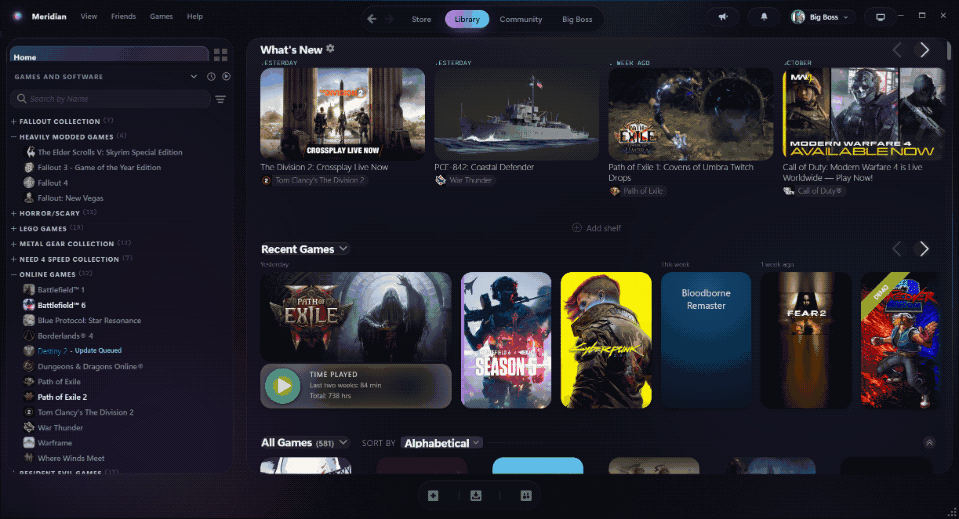
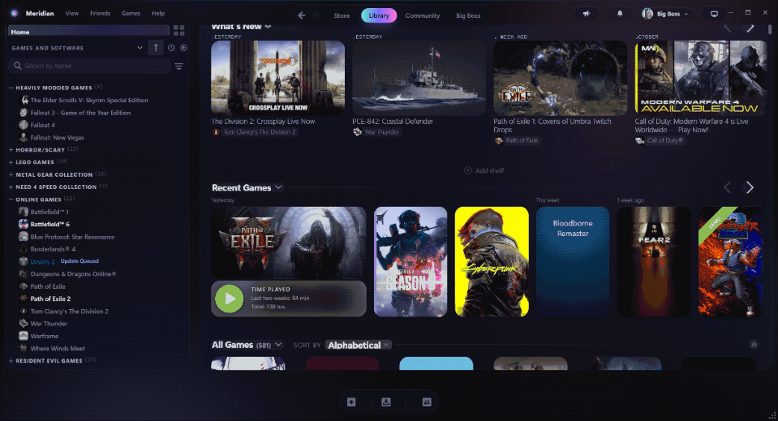

# Meridian

**Steam rebuilt as a floating, spatial workspace.** A Steam client theme for [Beyond Steam](https://github.com/OriginalSwayze/Beyond-Steam) and [Millennium](https://steambrew.app).

- **Frosted glass islands** for the game list and the page, floating over a slowly drifting aurora with film grain.
- **One slim top bar** holding the menus, a gradient pill navigator that glides between tabs, and pill-shaped account controls.
- **A centered glass dock** replaces the bottom bar; its labels slide out on hover.
- **A cinematic game page:** the hero art fades into the page, the play bar floats as a glass panel, and the Play button is a gradient pill with a sheen and a breathing glow.
- **Library covers tilt in 3D** toward the cursor with a moving glare, and a soft light follows the cursor across the islands.
- Menu items cascade in one by one; toasts, the sign-in screen, settings, friends, store and community pages are all restyled.

## Install

- **With [Beyond Steam](https://github.com/OriginalSwayze/Beyond-Steam) (easiest):** in Steam press **Ctrl+Shift+B**, open
  **Get more** and install **Meridian**.
- **By hand:** download **Meridian.zip** from the [latest release](https://github.com/OriginalSwayze/Meridian/releases/latest) and unzip
  it into `%APPDATA%\Beyond Steam\themes\Meridian` (Beyond Steam) or `Steam\millennium\themes\Meridian` (Millennium).

## Options

In Beyond Steam's **Theme options** tab (or **Millennium → Themes → Meridian**) you can change:

Color world (Aurora, Ember, Glacier, Verdant, Sakura, Monochrome, Custom) · Backdrop · Grain · Corner radius · Glass blur · Glass tint · Layout (Islands / Seamless) · Navigator · Game list density · What's New · Dock labels · Motion (Full / Calm / Still) · Cover hover · Cursor light · Privacy blur

Everything here is original: no other game's names, logos, art or fonts.

## License

MIT, see [LICENSE](LICENSE).
